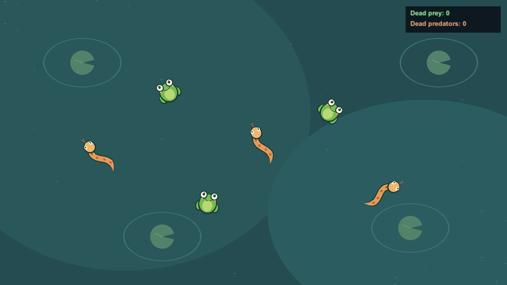

# Zoo World

A small 3D animal simulation built as a Unity technical assessment. Frogs and snakes roam a pond, collide through physics, and interact through a simple food chain. The game runs automatically from a top-down camera.

The project focuses on an extensible animal architecture: species are configured through ScriptableObjects, while movement, collision handling and food rules have separate responsibilities.



## Gameplay

- One randomly selected animal appears every **1–2 seconds**.
- **Frogs** are prey. They jump a fixed distance at a configurable interval. A change in visual scale and a ground shadow make the jump readable from above.
- **Snakes** are predators. They move continuously and eat other animals on contact. When two predators collide, the older instance survives.
- Prey bounce apart through Unity physics. Eaten animals disappear and increment the corresponding death counter.
- Each meal displays **Tasty!** below the predator. Death counters use **uGUI** and sit in the top-right corner.
- Animals can leave the camera view and steer back into it. The camera boundary provides a return direction rather than an invisible wall.

## Getting started

1. Clone the repository and open the project in **Unity 6000.6.5f1** through Unity Hub.
2. Let Unity restore packages and import the included assets.
3. Open [`Initialization.unity`](Assets/Core/Scenes/Initialization.unity) and enter Play Mode.

The simulation needs no player input. Starting directly from [`Game.unity`](Assets/Core/Scenes/Game.unity) is also supported.

For a player build, keep both scenes enabled in Build Settings, with `Initialization` first.

## Technology

| Tool | Role |
| --- | --- |
| Unity 6000.6.5f1 / C# | Game logic and 3D physics |
| Universal Render Pipeline 17.6.0 | Rendering |
| Zenject | Dependency injection, factories and service lifetimes |
| UniTask | Asynchronous scene and asset loading |
| Addressables 2.11.2 | Asynchronous asset loading with explicit ownership |
| Shapes | Editable vector artwork for animals and the pond |
| uGUI | Counters and meal feedback |
| Unity Test Framework 1.8.0 / NUnit | Automated checks |

## Architecture

The persistent `ProjectContext` installs shared services and starts the global state machine:

```text
BootStrapState → LoadLevelState → WorldGenerationState → GamePlayState
```

World preparation validates the scene and animal catalog. Gameplay starts spawning; leaving it stops the spawner, releases animals and resets the HUD. Cleanup does not count as an animal death.

| Component | Responsibility |
| --- | --- |
| `GameWorld` | Prepare, start and end a scene's gameplay session |
| `AnimalFactory` | Instantiate, initialize and activate a complete animal |
| `AnimalSpawner` | Select species and schedule periodic spawning |
| `AnimalMovementController` and movement behaviours | Planar motion, heading, jumps and camera return |
| `AnimalCollisionHandler` / `AnimalInteractionResolver` | Connect physical contacts to food-chain rules |
| `AnimalDeathStatistics` | Count confirmed gameplay deaths once |
| `AnimalHudController` | Present counters and position meal labels |

Animals share behaviour through composition. An `AnimalDefinition` supplies a unique ID, food role, prefab and movement settings. Settings are shared authoring data; timers, velocity and other runtime state belong to individual animals. The Rigidbody owns the heading of both the collider and artwork.

### Assets and loading

Animal prefabs use direct references and are instantiated through Zenject. The asset provider also supports asynchronous Addressables loading:

- `LoadAsync<T>` returns an `AssetLease<T>` owned by its caller.
- Address-loaded prefab instances retain their lease until the instance is destroyed.
- `ReleaseInstance` deactivates and destroys an instance; scene unloading is also supported.

Scene loading rejects overlapping requests. Because Unity cannot abort an ongoing native scene load, cancellation prevents its completion from advancing an obsolete game state.

## Adding a species

1. Duplicate an animal prefab and adjust its Shapes artwork and collider. Keep a separate visual child and use local **+Z** as forward.
2. Create an `AnimalDefinition` with a unique ID, food role, prefab and linear or jumping movement settings.
3. Add the definition to [`GameConfig.Animals`](Assets/Core/Settings/Configs/GameConfig.asset).

A species reusing existing movement needs no new species enum or food-rule branch. A new movement algorithm requires a settings type, a behaviour and a case in `AnimalMovementFactory`.

See [Project Overview](Docs/ProjectOverview.md) for prefab requirements and lifecycle details.

## Tests and validation

Open **Window → General → Test Runner**, select **EditMode**, and run `Template.StateMachine.Tests`. Coroutine tests explicitly enter Play Mode for physics and lifecycle checks.

The suite covers factory initialization, collisions, predation, movement, camera return, statistics, UI, asset ownership, scene loading and session restart. Tests verify the real project startup before exercising isolated scenarios with child DI containers.

Latest verification with Unity 6000.6.5f1:

- **88 tests passed**, with no skipped tests.
- Windows x64 player build succeeded.
- Standalone startup, spawning, rendering, camera return, cleanup and restart checked at **1600×900**, **1024×768** and **720×960**.

## Project layout

```text
Assets/Core/Scenes/       Initialization and gameplay scenes
Assets/Core/Prefabs/      Animal and environment prefabs
Assets/Core/Scripts/Game/ Gameplay, infrastructure, configuration and tests
Assets/Core/Settings/     Animal definitions, movement settings and game config
Assets/Plugins/          Included libraries and their documentation
Docs/                    Project overview and preview image
```

## Credits and licenses

Animal and environment artwork uses **Shapes** by **Freya Holmér**. See the [bundled Shapes README](Assets/Plugins/Shapes/README.md), [documentation](https://www.acegikmo.com/shapes/docs/) and [license](Assets/Plugins/Shapes/LICENSE).

Project license: [LICENSE](LICENSE). Third-party assets and libraries retain their own licensing terms.
